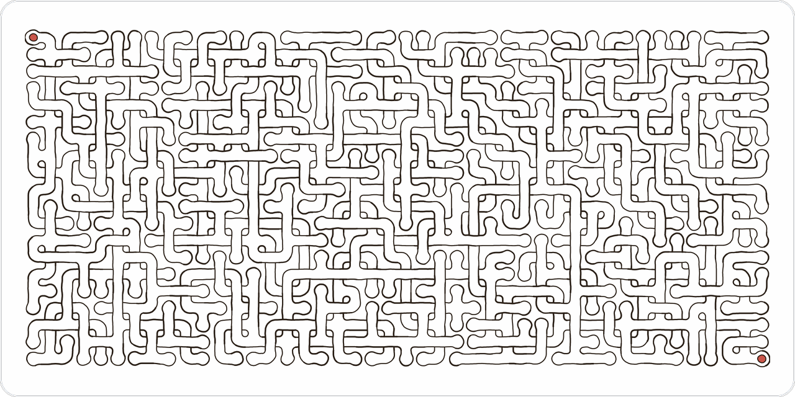

<h1 align="center">maze-rs</h1>

<p align="center">Fast weave mazes, generated in Rust, as SVG, PDF or text.</p>

<p align="center">
  <a href="https://maze.do.id.au/?maze=straight"><b>Play</b></a> &nbsp;·&nbsp;
  <a href="#quick-start">Quick start</a> &nbsp;·&nbsp;
  <a href="#documents">Documents</a> &nbsp;·&nbsp;
  <a href="#how-it-works">How it works</a>
</p>

<p align="center">
  
</p>

maze-rs makes **weave mazes**: mazes whose passages cross over and under each
other. It writes them as SVG, PDF or plain text, with an optional solution, an
optional hand-drawn look and a choice of styles. It is a port of the Python
generator [daleobrien/maze](https://github.com/daleobrien/maze), with the same
command line and the same drawing. Play them in the browser at
[maze.do.id.au](https://maze.do.id.au/?maze=straight).

## Quick start

```bash
make build                     # build the maze command
make svg W=30 H=20             # out/maze.svg and out/maze-solved.svg
make svg INK=1                 # drawn by hand, in ink
make pdf OPTS="--frame"        # out/maze.pdf, with a frame
make text W=20 H=10            # one in the terminal
make install                   # put maze on your PATH
make                           # list every task
```

`ID=...` fixes the maze: the same id always gives the same maze. See
[the maze command](docs/command.md) for everything else.

## Documents

| Document | What's in it |
| -------- | ------------ |
| [The maze command](docs/command.md) | `maze svg`, `pdf` and `text`, and the make tasks that run them |
| [Hand-drawn ink](docs/ink.md) | Drawing a maze by hand, with the sample maze |
| [Styles](docs/styles.md) | Corners, corridor width, dead ends, colours and frames |
| [As a library](docs/library.md) | Using the generator from Rust and WebAssembly |
| [How it works](docs/internals.md) | Reused tiles, the random numbers, the PDF writer, benchmarks and the differences from the Python version |

## How it works

`src/maze.rs` makes and solves the maze, and `src/renderers/` draws it: each
kind of tile is drawn once and reused in every cell of that kind, which keeps
the files small and fast to write. `tests/snapshot.rs` pins hashes of the
output for a set of maze ids, so a change can't silently alter what is
generated. [How it works](docs/internals.md) has the rest.

---

<p align="center"><sub>Part of <a href="https://daleobrien.github.io/#mazes">Mazes</a> &nbsp;·&nbsp; more at <a href="https://daleobrien.github.io">daleobrien.github.io</a></sub></p>
