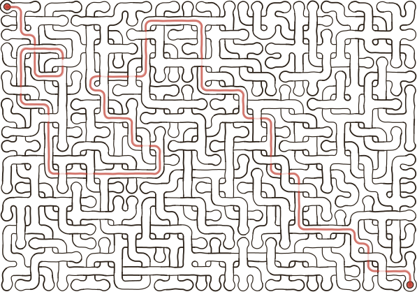

# maze-rs

A fast Rust generator for **weave mazes**: mazes whose passages cross over
and under each other. It writes them as SVG, PDF or plain text, with an
optional solution and an optional hand-drawn look.

It is a port of the Python generator
[daleobrien/maze](https://github.com/daleobrien/maze), with the same command line
and the same drawing.

<p align="center">
  
</p>

## Quick start

```bash
cargo build --release
maze svg maze.svg -s maze-solved.svg -W 23 -H 30    # maze and its solution
maze pdf my_maze.pdf -S -O L                        # straight lines, landscape
maze text -W 10 -H 8 -i my-maze                     # to the terminal
```

Run `maze` with no arguments to see all the options. The same maze id
(`-i`) always gives the same maze. The Makefile wraps the common tasks: run
`make` to list them.

## Hand-drawn ink

Add `-I` (`--ink`) to `svg` or `pdf` to draw the maze in brown ink on a
transparent background, with every wall wobbling slightly. The wobble is seeded from the maze id, so
a maze always comes out the same. The solved sample at the top was made
with:

```bash
maze svg /dev/null -I -s docs/sample-ink-solved.svg -W 30 -H 21 -i readme
```

No two cells look alike, so ink tiles can't be reused the way plain ones are.
Expect files several times bigger and slower to write
(`src/renderers/ink.rs`). `make ink` writes an ink SVG, its solution and a
PDF in one go, and `INK=1` does the same for `make svg` and `make pdf`.

## How it works

- Each kind of tile is drawn once and reused in every cell of that kind
  (`<defs>` and `<use>` in SVG, a Form XObject in PDF). This makes the files
  faster to write and smaller than the Python version's.
- `src/random.rs` is wyrand seeded from a hash of the maze id. It replaced a
  bit-for-bit copy of CPython's Mersenne Twister, which made generation
  about 3x slower.
- `src/renderers/pdf.rs` writes the PDF directly (no ReportLab), copying
  ReportLab's number formatting, transform merging and Bezier arcs.
- `tests/snapshot.rs` pins hashes of the text, SVG and PDF output for a set
  of maze ids, so changes can't silently alter what is generated.

Benchmarks for generation, solving and each renderer:

```bash
cargo bench          # or: make bench BENCH=render
```

## Differences from the Python version

- Mazes come from a different random number generator, so maze ids don't
  carry over between the two versions.
- The solver uses an explicit stack, so very large mazes (e.g. 168x240)
  can't hit a recursion limit.
- PDF metadata (creator/producer, dates in UTC) differs from ReportLab's.
- Invalid numbers print a one-line error instead of a Python traceback.
- `-I` (ink) is new here.
