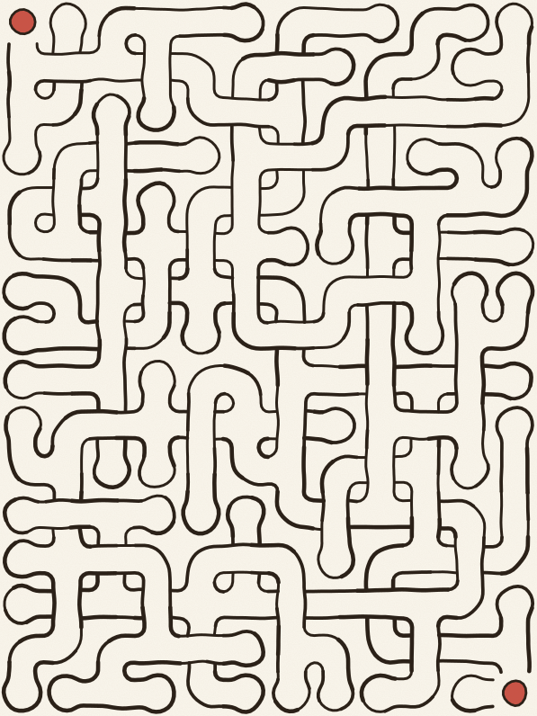

maze-rs
=======

A Rust port of the Python weave-maze generator in `../maze`. Same command
line and the same drawing, but a faster random number generator, so a given
`-i MAZE_ID` gives a different maze here than in the Python version (still
the same maze every time it is run here). Each
kind of tile is drawn once and reused in every cell of that kind (`<defs>` and
`<use>` in SVG, a Form XObject in PDF), which makes the files faster to write
and smaller than the Python version's.

```bash
cargo build --release
maze svg maze.svg -s maze-solved.svg -W 23 -H 30
maze text -W 10 -H 8 -i my-maze
maze pdf my_maze.pdf -S -O L
```

Run `maze` with no arguments to see all options.

Add `-I` (`--ink`) to `svg` or `pdf` for a hand-drawn look: brown ink on
paper, with every wall wobbling a little. The wobble is seeded from the maze
id, so a maze always comes out the same. Since no two cells look alike the
tiles can't be reused, so these files are several times bigger and slower to
write (`src/renderers/ink.rs`).

<p>
  
  
</p>

The sample above, and its solution, come from:

```bash
maze svg docs/sample-ink.svg -I -s docs/sample-ink-solved.svg -W 12 -H 16 -i readme
```

How parity is kept:

- `src/random.rs` is wyrand seeded from a hash of the maze id, so the same
  id always yields the same maze. It replaced a bit-for-bit copy of
  CPython's Mersenne Twister, which made generation about 3x slower.
- `src/renderers/pdf.rs` writes the PDF directly (no ReportLab), copying
  ReportLab's number formatting, transform merging and Bezier arcs.
- `tests/snapshot.rs` pins hashes of the text, SVG and PDF output for a
  set of maze ids, so changes can't silently alter what is generated.

Benchmarks for generation, solving and each renderer:

```bash
cargo bench
```

Differences from the Python version:

- Mazes come from a different random number generator (see above), so
  maze ids don't carry over between the two versions.

- The solver uses an explicit stack, so very large mazes (e.g. 168x240)
  can't hit a recursion limit.
- PDF metadata (creator/producer, dates in UTC) differs from ReportLab's.
- Invalid numbers print a one-line error instead of a Python traceback.
