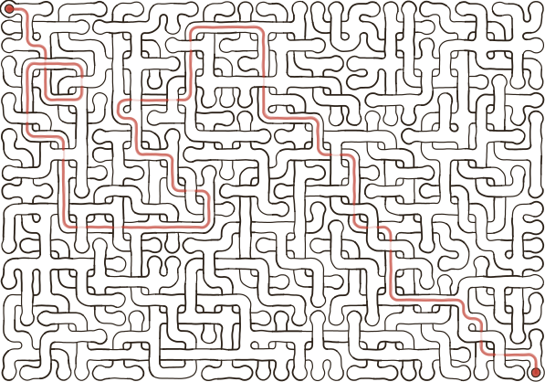

# Hand-drawn ink

[Back to the README](../README.md)

Add `-I` (`--ink`) to `svg` or `pdf` to draw the maze in brown ink on a
transparent background, with every wall wobbling slightly. The wobble is seeded
from the maze id, so a maze always comes out the same.

The start and end are drawn as in [Lubra](https://github.com/daleobrien/lubra):
the corridor opens into a ring with a red dot inside. `--ring` sets the ring's
radius, as a fraction of a cell (0.46 normally, up to 0.48); 0 draws a plain dot
instead.

Where a passage goes under another, its walls show faintly (at 20% opacity)
through the passage on top, drawn with the same pen so they join the visible
walls on either side. Mazes without crossings are drawn as before. This is in
the SVG only, not the PDF, which has no transparency.

With `-s`, the solution is pencilled over the ink.

<p align="center">
  
</p>

The maze above was made with:

```bash
maze svg /dev/null -I -s docs/sample-ink-solved.svg -W 30 -H 21 -i readme
```

and the cover at the top of the README, `docs/cover.png`, from:

```bash
maze svg cover.svg -I -W 44 -H 20 -i cover
```

drawn at 1280 by 640 on a white card with rounded corners.

No two cells look alike, so ink tiles can't be reused the way plain ones are.
Expect files several times bigger and slower to write (`src/renderers/ink.rs`).
`make ink` writes an ink SVG, its solution and a PDF in one go, and `INK=1`
does the same for `make svg` and `make pdf` ([the maze command](command.md)).
